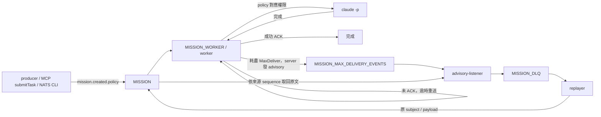

# JetRescue

用 NATS JetStream 練習任務派送、失敗重送、隔離與重新發布。任務從 producer 或 MCP server 發布，worker 依 subject 對應的 policy 啟動一個 Claude Code agent 執行，agent 完成後才 ACK；處理失敗的訊息耗盡投遞次數後由 listener 隔離到 DLQ，可再 replay。

## 1. 準備環境與設定

需要 Docker Desktop（或 Docker Engine）與 Docker Compose。Go、Claude Code CLI 與 NATS CLI 已包含在 Compose 服務中，主機不需要另外安裝。

下載或 clone 本 repository 後，進入 repository 根目錄（包含 `go.mod` 與 `docker-compose.yml` 的目錄）。以下所有命令均在此目錄執行。

首次使用，複製設定範例；已有 `.env.dev` 時保留原檔，依下表補齊設定：

```bash
cp .env.example .env.dev
```

| 變數 | 範例／預設值 | 用途 |
| --- | --- | --- |
| `APP_ENV` | `dev` | Compose 預設選用 `.env.dev`，其他環境的選法見下方 |
| `NATS_URL` | `nats://nats:4222` | 必填；容器透過服務名稱 `nats` 連線 |
| `MISSION_ACK_WAIT` | `30s` | 每次投遞後等待 ACK 的期限；須為正的 Go duration，例如 `5s`、`1m`。agent 執行期間 worker 每半個 AckWait 送一次 in-progress，避免長任務被重送 |
| `MISSION_MAX_DELIVER` | `3` | 同一訊息最多投遞幾次，包含第一次；須為正整數 |
| `CLAUDE_CODE_OAUTH_TOKEN` | 空 | worker 啟動 agent 時使用的 Claude 訂閱 token，產生方式見下方 |

`CLAUDE_CODE_OAUTH_TOKEN` 用 Claude 訂閱帳號（Pro、Max 等）產生，不需要 API key。在已安裝 Claude Code 的主機執行：

```bash
claude setup-token
```

依提示在瀏覽器授權後，終端會印出一組一年有效的 token；指令不會自動保存，請複製到 `.env.dev`。agent 的用量計入該帳號額度。說明見 [Claude Code Authentication](https://code.claude.com/docs/en/authentication#generate-a-long-lived-token)。

想快一點看到重送，可在 `.env.dev` 把 `MISSION_ACK_WAIT` 改成 `5s`。consumer 政策由 bootstrap 套用；producer 雖然共用設定載入函式，發送時只使用連線設定。

預設命令使用 `.env.dev` 作為容器環境。要使用其他環境，例如 `.env.testing`，請在檔案內設定 `APP_ENV=testing`，並在**每一條** Compose 命令加上相同的 `--env-file`：

```bash
docker compose --env-file .env.testing up -d
```

只在自訂環境檔內填入 `APP_ENV`，不會讓 Compose 自動找到該檔案。環境檔包含憑證，請保留在本機；`.env.dev` 已被忽略，自訂環境檔也須加入 `.gitignore`。

## 2. 啟動環境與初始化

```bash
docker compose up -d --build
docker compose ps
docker compose exec app go run ./cmd/bootstrap
```

首次執行會建置 `app` image（安裝 Claude Code CLI）並下載 Go dependencies。修改 `Dockerfile` 後需再次加上 `--build`。bootstrap 成功時會輸出 `JetStream bootstrap completed`。

確認容器內可找到 Claude Code：

```bash
docker compose exec app claude --version
```

| Compose 服務 | 功能 |
| --- | --- |
| `app` | 由 `Dockerfile` 建置的 Go 開發容器，含 Claude Code CLI；掛載本機程式碼，保持待命供執行 `go run` 等命令，`8080` 對外提供 MCP server |
| `nats` | 啟用 JetStream 的 NATS Server，資料保存在 `nats-lab-data` volume |
| `nats-tools` | 常駐的 NATS CLI 容器，供發布訊息及檢查 streams／consumers |

`up -d` 只啟動環境，**不會自動執行 worker、listener 或 MCP server**。

開三個終端，分別執行以下命令並保持運行。另一個終端用來發布與查詢訊息。

終端 A，啟動 worker：

```bash
docker compose exec app go run ./cmd/worker
```

預期看到 `MISSION worker started`。

終端 B，啟動 listener：

```bash
docker compose exec app go run ./cmd/advisory-listener
```

預期看到 `advisory listener started`。listener 會在啟動時建立自己的 `MISSION_DLQ_COLLECTOR` consumer。

終端 C，啟動 MCP server（只用 producer 發任務時可省略）：

```bash
docker compose exec app go run ./cmd/server
```

預期看到 `MCP HTTP server listening on :8080`。

## 3. 發送任務

任務 payload：

```json
{"task_id":"A-1001","prompt":"今天天氣真好","attachment":[{"name":"spec","uri":"https://example.com/spec"}]}
```

| 欄位 | 規則 |
| --- | --- |
| `task_id` | 必填；只能包含英數字、`_`、`-`，同時作為 agent 工作目錄名稱與 JetStream 去重 ID |
| `prompt` | 必填、非空白 |
| `attachment` | 選填；會以「參考資料」清單附加在 prompt 後面，agent 不會自動下載 |

policy 決定發布的 subject，也決定 agent 的權限：

| policy | subject | agent 權限 |
| --- | --- | --- |
| `readonly` | `mission.created.readonly` | 只讀：Read、Grep、Glob |
| `scoped` | `mission.created.scoped` | 可在任務工作目錄內讀寫：加上 Edit、Write |
| `approval` | `mission.created.approval` | 只讀；寫入、修改、執行會被攔下，記錄為待人類允許的操作 |
| `decision` | `mission.created.decision` | 只讀加 WebSearch、WebFetch；只整理請示，不自行決定 |

每個任務在容器內的 `/tmp/jetrescue/<task_id>` 執行，碰不到 `/app` 的程式碼。

### 用 producer 發送

```bash
docker compose exec app go run ./cmd/producer
```

producer 固定以 `decision` policy 發布 `task_id=A-1001` 的任務，成功時輸出 `published task to MISSION seq=<n>`，代表已收到 JetStream PubAck。`task_id` 同時是去重 ID，duplicate window 內重複執行不會產生新訊息。

### 用 MCP 發送

MCP server 以 Streamable HTTP 提供 `http://localhost:8080/mcp`，工具為 `submitTask`：

| 參數 | 意義 |
| --- | --- |
| `prompt` | 必填；任務內容 |
| `policy` | 必填；`decision`、`approval`、`scoped`、`readonly` 其中之一，其他值回傳錯誤 |
| `attachment` | 選填；`[{"name":"...","uri":"..."}]` |

`task_id` 由 server 產生，回傳 `task_id`、`stream`、`sequence`。在主機的 Claude Code 加入此 server：

```bash
claude mcp add --transport http jetrescue http://localhost:8080/mcp
```

### 確認處理結果

worker 會記錄 `processing task`，agent 結束後記錄 `agent finished`（含 `session_id`、`turns`、`cost_usd`、`result_chars`、`pending_approvals`），最後 ACK。agent 的回覆全文目前只保存在容器內的 Claude Code session 檔：

```bash
docker compose exec app sh -c 'ls /root/.claude/projects/-tmp-jetrescue-<task_id>/'
```

查詢 consumer 的 pending／ack pending 狀態：

```bash
docker compose exec nats-tools nats consumer info MISSION MISSION_WORKER
```

發布成功不代表任務完成；請搭配 worker 輸出與 consumer 狀態判讀。

## 4. 觀察重送與 DLQ

透過 NATS CLI 發送一筆 `prompt` 為空的任務，讓 worker 在啟動 agent 前就失敗（不消耗 Claude 額度）：

```bash
docker compose exec nats-tools nats pub mission.created.readonly '{"task_id":"DLQ-DEMO-001","prompt":""}'
```

worker 會記錄 `process mission failed; message remains unacknowledged` 並保持未 ACK。缺少 `task_id`、格式不符或 subject 無對應 policy 的訊息也會走同一路徑。預設最多投遞 3 次，各次之間等待 `AckWait`，最後由 listener 隔離到 DLQ。請等到 listener 出現 `message quarantined`，再檢查：

```bash
docker compose exec nats-tools nats stream info MISSION_DLQ
docker compose exec nats-tools nats stream get MISSION_DLQ 1
```

`1` 是 **DLQ stream 的 sequence**。已有資料時，先從 stream info 確認 First／Last Sequence，再換成要查的實際編號；DLQ sequence 與來源 `MISSION` sequence 不一定相同。

DLQ envelope 包含 `quarantine_id`、`source.stream`、`source.consumer`、`source.subject`、`source.stream_seq`、時間、headers 與 `payload_base64`。比對來源與原始 payload，確認是本次送入的訊息。

NATS CLI 會使用容器中的 `NATS_URL`，與 Go 指令連到相同 server。

## 5. Replay 單筆 DLQ 訊息

```bash
docker compose exec app go run ./cmd/replayer -sequence 1 -request-id replay-demo-001
```

| 參數 | 意義 |
| --- | --- |
| `-sequence` | 必填、正整數；要讀取的 `MISSION_DLQ` sequence |
| `-request-id` | 必填；同一次操作重試時維持相同值，新一次操作使用新值 |

成功時會輸出 `DLQ message replayed`，包含原 subject、新的 stream sequence 與 replay ID。

replay 還原原始 payload 與 headers，發布回原 subject，**不刪除 DLQ 紀錄，也不修改 payload**。原文若仍是無效任務（例如空的 `prompt`），worker 會再次失敗並可能產生新的 DLQ 紀錄；這表示 replay 路徑運作，不表示任務已修復。

同一 request ID 的去重依賴 JetStream duplicate window，不能視為永久的 exactly-once 保證。

## 6. 驗證 listener 停機後補處理

1. 在終端 B 用 `Ctrl+C` 停止 listener，保持 worker 與 NATS 運行。
2. 使用前面的發布命令，換一個新的 `task_id` 送入失敗訊息。
3. 等待重試耗盡，確認 event stream 有新增事件；DLQ 此時不應出現該筆訊息。
4. 重新執行 listener 命令，確認出現 `message quarantined`，並在 DLQ 找到對應來源。

檢查命令：

```bash
docker compose exec nats-tools nats stream info MISSION_MAX_DELIVERY_EVENTS
docker compose exec nats-tools nats stream info MISSION_DLQ
docker compose exec nats-tools nats consumer info MISSION_MAX_DELIVERY_EVENTS MISSION_DLQ_COLLECTOR
```

比較操作前後的 sequence／訊息數與 payload，避免把歷史資料當成本次結果。原始訊息與 advisory 必須仍保存在各自 stream，listener 才能補處理。

## 7. 修改設定、停止與排錯

修改 `.env.dev` 後，先停止 worker／listener／MCP server，再重新建立使用環境檔的容器、執行 bootstrap，最後重啟這些程序：

```bash
docker compose up -d --force-recreate app nats-tools
docker compose exec app go run ./cmd/bootstrap
```

單純 `docker compose restart` 不會載入新的容器環境設定。bootstrap 會更新 mission consumer 政策；已存在的 streams 只會確認存在，不會自動修改設定。

| 現象 | 檢查方式 |
| --- | --- |
| 找不到 `.env.dev` | 從 `.env.example` 建立設定檔，確認位於 Compose 檔案旁 |
| 連不上 NATS | 檢查 `docker compose ps` 與 `docker compose logs nats`；容器內使用 `nats://nats:4222` |
| 找不到 stream／consumer | 先執行 bootstrap；collector consumer 在 listener 啟動時建立 |
| 訊息沒被處理 | 確認 worker 正在運行，subject 為 `mission.created.<policy>`，且 `task_id`、`prompt` 符合規則 |
| `exec: "claude": executable file not found` | 容器仍是舊 image；執行 `docker compose up -d --build` |
| agent 執行失敗、提示未登入 | 確認 `.env.dev` 已設定 `CLAUDE_CODE_OAUTH_TOKEN`，並已 `--force-recreate` 容器 |
| 沒進 DLQ | 確認訊息會讓 worker 失敗、已等到投遞次數耗盡、listener 正在運行 |
| 從主機連 NATS | 使用 `nats://localhost:4222`；`http://localhost:8222` 是監控入口，不是業務 API |

用 `Ctrl+C` 停止各個前景 Go 指令，再關閉環境：

```bash
docker compose down
```

這會保留命名 volume 中的 JetStream 資料，下次啟動仍可讀取歷史訊息。

## 專案結構與資料流

```text
.
├── README.md                     # 使用、設定與排錯指南
├── AGENTS.md                     # agent 操作與修改本專案的規則
├── Dockerfile                    # app 開發容器：Go + Claude Code CLI
├── docker-compose.yml            # app、NATS、NATS CLI 與持久化 volume
├── .env.example                  # 可提交的設定範例
├── .env.dev                      # 本機設定，不提交
├── bootstrap.sh                  # 容器內 bootstrap 的簡易入口
├── go.mod / go.sum               # Go 版本與依賴
├── cmd/
│   ├── bootstrap/main.go         # 建立 streams 與 mission consumer
│   ├── producer/main.go          # 發布固定的 decision 任務
│   ├── server/main.go            # MCP HTTP server（:8080/mcp）
│   ├── worker/main.go            # 交給 agent 處理，成功後 ACK
│   ├── advisory-listener/main.go # 找回重試耗盡的訊息並發布至 DLQ
│   └── replayer/main.go          # 依 DLQ sequence 發布回原 subject
└── internal/
    ├── config/nats.go            # 載入與驗證連線／consumer 設定
    ├── task/                     # 任務 payload 與 policy 定義
    ├── messaging/                # policy ↔ subject 對應、發布任務
    ├── mcp/                      # MCP server 與 submitTask 工具
    └── agent/                    # 解析任務、依 policy 啟動 claude CLI
```



| 資源 | 設定 |
| --- | --- |
| `MISSION` | 收錄 `mission.>`，使用 Limits retention |
| `MISSION_WORKER` | durable pull consumer，過濾 `mission.created.*`，explicit ACK |
| `MISSION_MAX_DELIVERY_EVENTS` | 收錄 `$JS.EVENT.ADVISORY.CONSUMER.MAX_DELIVERIES.MISSION.MISSION_WORKER` |
| `MISSION_DLQ_COLLECTOR` | listener 的 durable consumer，處理成功才確認 advisory |
| `MISSION_DLQ` | 收錄 `dlq.mission.>`，保存隔離 envelope |

## 開發與目前範圍

```bash
docker compose exec app go build ./cmd/...
```

此命令確認所有 Go 入口可以編譯。實際行為請依前面的任務處理、DLQ、replay 與 listener 補處理流程驗證。

目前限制：

- agent 結果只寫入 worker log，沒有發布到 result subject；`approval` 被攔下的操作與 `decision` 的請示尚未送交人類，也沒有核准後續跑的流程。
- `readonly` 實測下 Claude Code 仍會執行 `pwd`、`ls` 等唯讀 shell 指令，權限比工具清單寬。
- agent 工作目錄是空的，`attachment` 只以文字附在 prompt 中。
- 尚未提供 agent 身分／專屬 inbox、PostgreSQL、REST API 或批次 replay。這是本機開發環境，NATS 與 MCP server 目前未設定驗證或 TLS。
